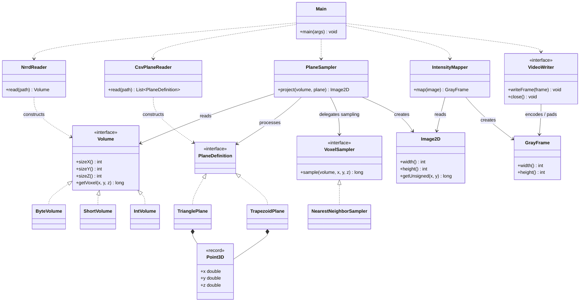

# Software Design (OOD) — Ex1: 3D Volume Plane Projection

**Version:** 0.1 — proposed detailed design  
**Status:** Architecture for review; no production Java implementation has been written yet.  
**Related documents:** [README.md](README.md) · [SRS.md](SRS.md)

## 1. Purpose

This document defines the responsibility of each component, the dependencies between components, and the intended public interfaces for the 3D volume projection application. It builds on the approved preliminary architecture and the current SRS. It intentionally leaves unresolved projection mathematics to the separate algorithm-design stage.

**Design goals:** maintainability, correctness, deterministic behavior, unit-testability, and fast slice generation. Parsing, geometry, slice sampling, intensity conversion, and video encoding must be independently testable.

## 2. Architectural overview

```text
                         Main (CLI orchestration)
                          /              \
                  NrrdReader          CsvPlaneReader
                       |                    |
                     Volume           PlaneDefinition(s)
                       \                    /
                            PlaneSampler
                                 |
                              Image2D
                                 |
                           IntensityMapper
                                 |
                              GrayFrame
                                 |
                              VideoWriter
                                 |
                                MP4
```

- `Main` coordinates operations but does not implement the projection math.
- Input parsing is independent of image rendering.
- `PlaneSampler` knows neither file formats nor MP4 encoding.
- Voxel sampling is abstracted by `VoxelSampler`; the first strategy is nearest neighbour.
- The volume is immutable/read-only after loading.
- A single normalization range is computed from the volume for the entire video.

## 3. Proposed class diagram (UML)

The following Mermaid diagram is rendered automatically by GitHub when viewing this Markdown file.



The diagram focuses on logical relationships, not every getter or constructor. `VideoWriter` is an interface to avoid tying the rest of the system to one encoding library.

## 4. Class and interface contracts

| Component | Responsibility | Important contract |
| --- | --- | --- |
| `Volume` | Read-only 3D raster access | Exposes dimensions and unsigned voxel values as `long`. |
| `ByteVolume` | Store unsigned 8-bit data | Owns a contiguous `byte[]`; interprets bits as 0–255. |
| `ShortVolume` | Store unsigned 16-bit data | Owns a contiguous `short[]`; interprets bits as 0–65,535. |
| `IntVolume` | Store unsigned 32-bit data | Owns a contiguous `int[]`; converts to unsigned `long` when reading. |
| `Point3D` | Immutable coordinates | Holds finite `double` values; no mutation. |
| `PlaneDefinition` | Common type for 3/4-point geometry | Validated triangle/trapezoid types; exact rasterization mapping is deferred. |
| `TrianglePlane` | An isosceles triangle | Three ordered points `A, B, C`. |
| `TrapezoidPlane` | An isosceles trapezoid | Four ordered points `A1, A2, B, C`; verify coplanarity and parallel bases. |
| `VoxelSampler` | Sample the volume at real-valued coordinates | Strategy abstraction; returns an unsigned value as `long`, or zero when outside. |
| `NearestNeighborSampler` | Initial implementation of `VoxelSampler` | Deterministic coordinate rounding and boundary checks (boundary policy to be finalized). |
| `PlaneSampler` | Calculate one 2D sampled slice | Takes `Volume` and `PlaneDefinition`, returns `Image2D`; no file or video code. |
| `Image2D` | Hold original sampled intensity values | Proposed contiguous `int[]` of raw unsigned-32-bit patterns, exposed as unsigned `long` when needed; initialized to zero. |
| `NrrdReader` | Parse/decode an attached-data 3D NRRD | Supports unsigned 8/16/32-bit scalar data, `raw` and `gzip`, and applicable endian conventions. |
| `CsvPlaneReader` | Read and validate ordered plane records | 9 numbers = triangle; 12 = trapezoid; diagnostic includes filename and source line number. |
| `IntensityMapper` | Convert sampled source intensities to display levels | Uses one fixed global min/max from the loaded volume; emits 8-bit grayscale, does not change source data. |
| `GrayFrame` | Transport grayscale pixels to encoder | Contains `width`, `height` and `byte[]` in row-major order. |
| `VideoWriter` | Encode fixed-size MP4 video | 30 FPS playback; centre each image on a black canvas, preserving its proportions and CSV order. |
| `Main` | CLI orchestration and failures | Parse args, validate inputs, load volume, calculate global range, project planes, encode, finalize or clean up. |

### 4.1 `Volume` and array indexing

The logical storage order is **x-fastest**:

```text
index(x, y, z) = x + sx * (y + sy * z)
```

All storage classes apply this same mapping. The NRRD reader is responsible for respecting the file's axis layout and making the loaded logical view consistent with the chosen convention. Out-of-bounds protection for *sampled* coordinates belongs to `VoxelSampler`; direct `Volume.getVoxel` may require valid integer indices and fail explicitly when called incorrectly.

For unsigned 32-bit samples, `long` is necessary for a nonnegative public value. For `Image2D`, `int[]` can hold the same **32-bit pattern** without losing the original sample: converting back uses `Integer.toUnsignedLong(...)`. This is a design proposal to reduce per-frame memory compared with `long[]`.

### 4.2 Proposed key Java signatures

These are **API sketches**, not complete source files:

```java
public interface Volume {
    int sizeX();
    int sizeY();
    int sizeZ();
    long getVoxel(int x, int y, int z);
}

public record Point3D(double x, double y, double z) {}

public interface PlaneDefinition {}

public interface VoxelSampler {
    long sample(Volume volume, double x, double y, double z);
}

public final class PlaneSampler {
    public PlaneSampler(VoxelSampler voxelSampler) { /* ... */ }
    public Image2D project(Volume volume, PlaneDefinition plane) { /* ... */ }
}

public interface VideoWriter extends AutoCloseable {
    void writeFrame(GrayFrame frame) throws Exception;
    @Override void close() throws Exception;
}
```

`Image2D` will expose dimensions and safe pixel access. Its internal array will not be publicly mutable. The construction/validation APIs of geometry objects will be finalized along with the geometry tolerance policy.

### 4.3 Data-flow and validation sequence

1. Parse the three command-line arguments (NRRD, CSV, MP4 destination).
2. Parse all CSV rows, preserving order and source line numbers in diagnostics.
3. Validate every plane **before** producing an MP4; reject an invalid row with a clear error and nonzero exit code.
4. Load the 3D NRRD once and check its dimensions, type, compression, length, and byte order.
5. Calculate volume intensity min/max once. Compute all proposed frame dimensions and the maximum video canvas size.
6. For each plane in CSV order, produce one `Image2D`, map it to an 8-bit `GrayFrame`, and pass it to `VideoWriter`.
7. Finalize the MP4 only after all frames succeed; on failure, discard incomplete output where possible and return a nonzero exit code.

Implementation detail: using a temporary output file followed by rename is one possible way to avoid leaving a misleading partial MP4; it must be tested against the chosen encoder and operating system.

## 5. Testing boundaries

- **`Volume` tests:** x-fastest indexing and values at all corners; unsigned 8/16/32-bit edge values.
- **Geometry tests:** well-formed / degenerate triangle and trapezoid; equal-side tolerance; coplanarity, parallel bases, point ordering.
- **`VoxelSampler` tests:** integer and fractional coordinates; negative and upper-edge coordinates; zero for outside; deterministic tie rounding.
- **`PlaneSampler` tests:** known synthetic volumes and analytically predicted slices, including non-axis-aligned planes and image boundaries.
- **`NrrdReader` tests:** RAW/GZIP, 8/16/32-bit, little/big endian where applicable, invalid/truncated payloads.
- **`CsvPlaneReader` tests:** 9/12 coordinate records, mixed shapes, malformed numbers and row-specific diagnostics.
- **Video tests:** 30-FPS metadata, constant canvas dimensions, black padding, grayscale mapping, exact frame count and CSV order.
- **Performance tests:** warmed-up slice-generation FPS on a `500³` byte volume; measure independently of I/O and video encoding and record machine/JVM details.

## 6. Performance design constraints

The target is at least **30 FPS** (required), aiming for **100 FPS or more** for a `500³` 8-bit volume, following the assignment wording. The MP4 *playback rate* is separately fixed to 30 FPS.

The design should permit these optimizations **without prematurely implementing them**:

- Primitive arrays instead of nested boxed objects.
- Avoid allocating `Point3D` objects or doing unnecessary square roots inside per-pixel loops.
- Precompute plane basis vectors and row increments once per slice.
- Investigate primitive fast paths or JVM inlining if interface dispatch appears in profiling.
- Reuse frame buffers if allocation/GC becomes a measured bottleneck.
- Benchmark correctness first, then profile actual bottlenecks.

## 7. Decisions adopted so far

| Topic | Decision |
| --- | --- |
| Language | Java |
| 3D storage | Contiguous primitive array, by bit depth |
| CSV rows | 9 or 12 numeric values per record, no header |
| CSV coordinates | Voxel-index coordinates (physical-space conversion is future work) |
| Supported geometry | Isosceles triangles and isosceles trapezoids |
| Initial voxel sampling | Nearest neighbour |
| Outside-volume sample | Zero |
| Invalid CSV geometry | Stop with file/line/reason diagnostic; no partial video |
| NRRD data | Attached RAW/GZIP, unsigned 8/16/32-bit initially |
| Video format | MP4, 30 FPS playback, one frame per input plane, in order |
| Variable slice sizes | Centre on a uniform black canvas without stretching |
| Display mapping | 8-bit grayscale, one fixed min/max mapping for the entire video |
| Slice throughput | >30 FPS required; 100+ FPS expected/target |

## 8. Open decisions — do not treat these as finalized

1. **Final triangle rasterization:** pixel-centre convention, handling of boundary pixels, and whether to follow the assignment's unit-step scanlines versus the aspect-ratio-preserving alternative. The *logical* triangle dimensions remain `ceil(|BC|)` by `ceil(|AB|)` in the SRS draft.
2. **Trapezoid dimensions and scanning:** exact 2D mapping and row layout from `A1, A2, B, C`.
3. **Validation tolerances:** choose and document relative/absolute tolerances; floating-point data cannot be tested using exact equality.
4. **Rounding at volume boundaries:** clarify whether out-of-volume means the *continuous* point is outside before rounding or the rounded voxel index is outside.
5. **CSV details:** treatment of blank lines and comments.
6. **NRRD external-data support:** scope of `.nhdr` or `data file` headers if required by the selected datasets.
7. **MP4 implementation:** choose and test an encoder/library or external FFmpeg integration; confirm the exact Java CLI satisfies the demo requirement despite the Python example.
8. **Unusually large volumes:** actual JVM heap/memory limits, since file dimension bounds do not guarantee that all combinations fit in a given machine's RAM.

## 9. Next milestones

1. Review/approve this architecture and publish `DESIGN.md`.
2. Complete the **Algorithm Design** document, including mathematical mapping and pseudocode for both shapes.
3. Select NRRD files and document format variants required by the dataset.
4. Implement one component at a time with JUnit tests and small Git commits.
5. Integrate CLI, MP4 output, benchmarking, and the final experiment report.

---

This design document specifies the planned decomposition. It does **not** claim that any class, parser, encoder, or performance target is already implemented or verified.
